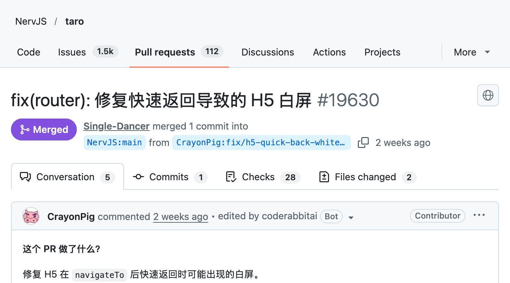
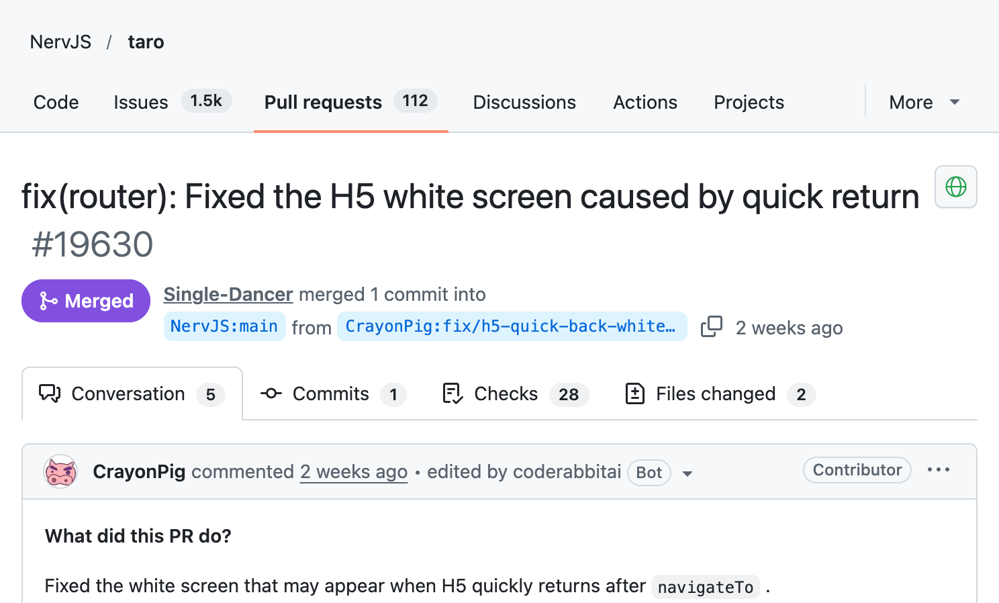

<picture>
  <source srcset="https://vpdpersonal.github.io/VPDPersonal/banners/aspid-translator-github/banner.webp" type="image/webp" />
  
</picture>

Read pull requests, issues, comments, commit messages and READMEs in your language.
Aspid.Translator.GitHub is a free Chrome extension that translates text right on GitHub
and keeps code, links and mentions intact.

## Installation

[**Chrome Web Store search**](https://chromewebstore.google.com/search/Aspid.Translator.GitHub) · [**GitHub Releases**](https://github.com/VPDPersonal/Aspid.Translator.GitHub/releases)

Requires Chrome 138 or later on desktop. Public downloads are pending.

## Before and after

<table>
  <tr>
    <th scope="col">Chinese original</th>
    <th scope="col">English translation</th>
  </tr>
  <tr>
    <td width="50%" valign="top"></td>
    <td width="50%" valign="top"></td>
  </tr>
</table>

[View the example pull request](https://github.com/NervJS/taro/pull/19630)

## How to use

1. Click the extension icon in Chrome and choose your language.
2. Open a GitHub page. Translation starts automatically. If prompted, click **Download translation model**.
3. Click **Show original** beside a translation, or use the bottom-right button to switch the whole page.

Translation runs on your device. [Privacy policy](PRIVACY.md)

[**Report a problem**](https://github.com/VPDPersonal/Aspid.Translator.GitHub/issues)

## Support the project

If this extension helps you read GitHub in your language, [star it on GitHub](https://github.com/VPDPersonal/Aspid.Translator.GitHub) or support its development on Ko-fi.

