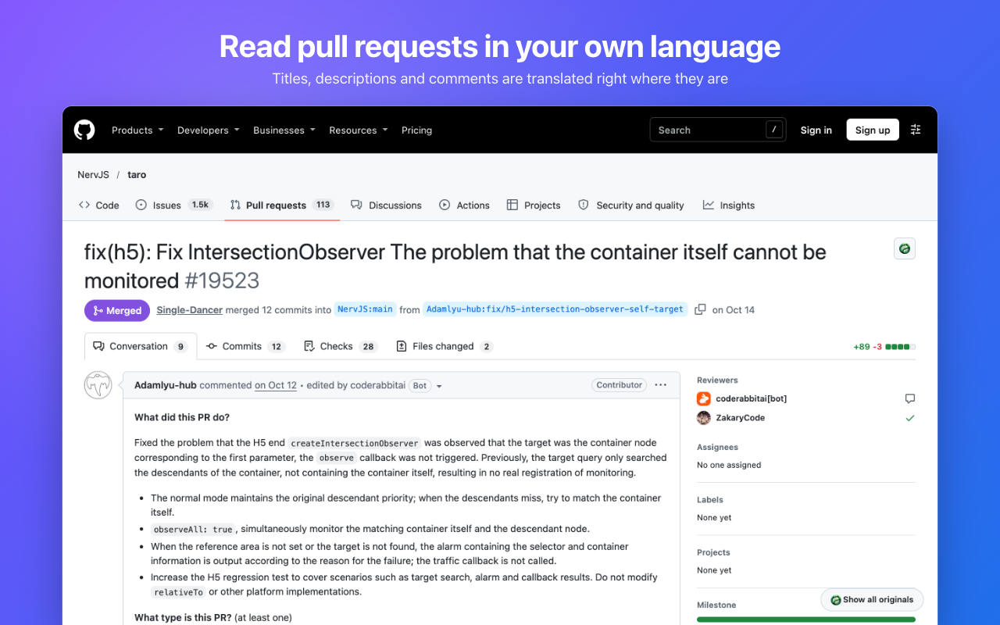

<picture>
  <source srcset="https://vpdpersonal.github.io/VPDPersonal/banners/aspid-translator-github/banner.webp" type="image/webp" />
  
</picture>

Aspid.Translator.GitHub is a free Chrome extension for reading pull requests, issues and
documentation in your language on GitHub. It translates text in place and keeps code,
links and mentions intact.

## Installation

Requires desktop Chrome 138 or newer. The extension is currently available as a private
preview to people with access to this repository.

1. Open the latest successful run on `main` in [GitHub Actions](https://github.com/VPDPersonal/Aspid.Translator.GitHub/actions/workflows/validate.yml?query=branch%3Amain).
2. Under **Artifacts**, download the `asp-translator-github-…` archive. Unzip it, then unzip
   the extension ZIP inside.
3. Open `chrome://extensions`, turn on **Developer mode**, and click **Load unpacked**.
   Select the extracted folder containing `manifest.json`.

To update, replace the contents of that folder with a newer build, click **Reload** on
the extension card in `chrome://extensions`, and refresh any open GitHub tabs.

## Use the extension

1. Open or refresh a supported page on `github.com`. If Chrome needs to
   download a language model, click **Download translation model** in the bottom right.
2. Use **Show original** next to a translated comment or document to check the source.
   Use the floating button or **Alt+Shift+J** (**Option+Shift+J** on macOS) to switch the whole page.
3. Click the extension icon in Chrome’s **Extensions** menu to choose one of 39 target
   languages, change the shortcut, or choose which content to translate. Automatic translation
   is on by default.

## Where it works

| GitHub page | Content you can translate |
|---|---|
| Pull requests and issues | Titles, descriptions, comments, review threads and list titles |
| Commits and Compare | Commit titles and descriptions |
| Repositories and Wiki | READMEs, rendered Markdown files, About descriptions and wiki pages |
| Discussions and releases | Discussion titles, replies and accepted answers, plus release titles and notes |
| Home and Feed | Activity cards when you are signed in |

The extension skips text already in your target language and preserves code and diffs.
Titles show the original when you hover over them.

## Privacy

Chrome translates on your device. It downloads a language model from Google when a
language pair needs one. The extension saves your preferences locally, and only you
see the translated page. See the [privacy policy](PRIVACY.md).

## Help and support

If a page stays in its original language, check your target language and enabled content
in the extension settings. For a bug report, include the page URL, your Chrome and extension
versions, the target language and steps to reproduce.

[**Open an issue**](https://github.com/VPDPersonal/Aspid.Translator.GitHub/issues) · [Star on GitHub](https://github.com/VPDPersonal/Aspid.Translator.GitHub)
